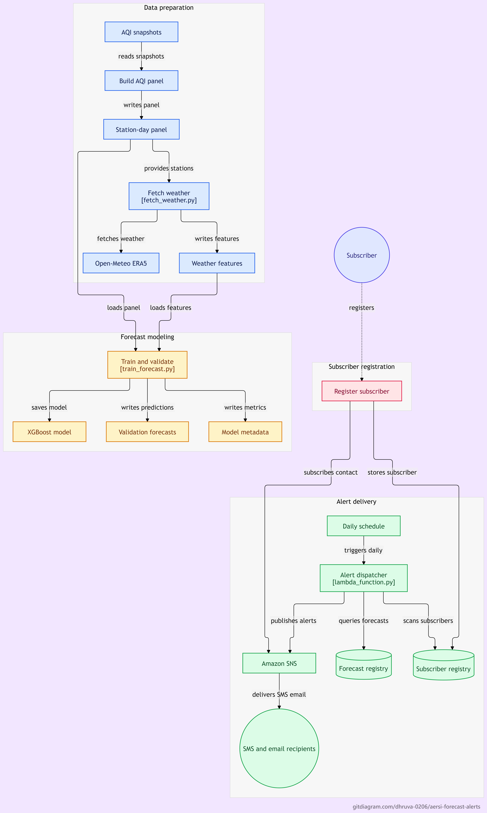

# AERSI Forecast + Alert System
### Air Exposure Severity Index — Predictive AQI Forecasting for India

> **Environmental Hacks Hackathon** · WeMakeDevs × AWS · Air Track · Oct 2026  
> Built by **Dhruva Chakrabarty**

---

## What It Does

AERSI predicts **next-day AQI and computes AERSI risk scores per station** for **583 Indian monitoring stations** using an XGBoost model trained on 9 months of air quality data + meteorological features. When the forecast crosses dangerous thresholds (AQI > 200), AWS Lambda automatically dispatches **SMS and email alerts** to subscribers in affected cities — giving people 24 hours of advance warning to protect themselves.

---

## The Problem

India has over 200 million people living in cities with hazardous air quality. Current AQI systems report what's happening *right now* — but by the time a "Severe" reading appears, the damage is already done. Children, elderly people, and those with respiratory conditions need **advance notice**, not real-time readings.

---

## AERSI Formula

```
AERSI = PL^0.50 × EPF^0.25 × VSF^0.25
```

Components (30-day rolling window):
- **PL (Pollution Load)** = weighted mean of (pollutant / WHO_limit)^0.6 across PM2.5, PM10, NO2, SO2, Ozone
  - Weights: PM2.5 = 0.40, PM10 = 0.20, NO2 = 0.15, Ozone = 0.15, SO2 = 0.10
  - WHO limits: PM2.5 = 15, PM10 = 45, NO2 = 25, Ozone = 60, SO2 = 40 µg/m³
- **EPF (Exposure Persistence Factor)** = 1 + fraction(days with AQI > 100 in window) [range 1.0–2.0]
- **VSF (Variability Severity Factor)** = 1 + tanh(median day-to-day AQI change / 45) [range 1.0–2.0]

Severity bands: Very Low (<0.6) | Low (<1.0) | Moderate (<1.5) | High (<2.0) | Extreme (≥2.0)

Current results from 148 CPCB snapshots (Jan–Sep 2026):
- 572 stations, 59,537 station-days, mean AERSI 1.347
- Band split: Very Low 0.1% | Low 12.8% | Moderate 57.1% | High 24.9% | Extreme 5.1%

---

## Architecture



### AWS Services Used
| Service | Role |
|---|---|
| **AWS Lambda** (Python 3.12) | Daily forecast dispatcher + alert logic |
| **Amazon SNS** | SMS & email delivery to subscribers |
| **Amazon DynamoDB** | Subscriber registry (city, contact, preferences) |
| **Amazon EventBridge** | Daily schedule trigger (cron 8 PM IST) |

**Subscriber sign-up endpoint** (Lambda Function URL):
`https://bhxkqp2tyfbr4scvhwpt7foe7i0ccgmr.lambda-url.ap-south-1.on.aws/`
Auth: NONE · CORS enabled · public endpoint for subscriber sign-up

## Live Data Pipeline

- GitHub Actions runs daily at 10:30 AM IST (`.github/workflows/daily_pipeline.yml`).
- `src/fetch/fetch_snapshot.py` hits the data.gov.in CPCB API, paginates, and saves a daily CSV to `data/snapshots/`.
- `src/build_station_panel.py` pivots the snapshots into a wide station-day panel with pollutant columns.
- `src/compute_aersi.py` computes WHO-normalized AERSI per station.
- Requires `DATA_GOV_API_KEY` in GitHub Secrets (Settings → Secrets and variables → Actions).

## How It Works

1. **Data collection** — 148 daily AQI snapshots from 583 Indian monitoring stations
   are parsed into a station-day panel (66,881 rows).
2. **Weather enrichment** — Open-Meteo ERA5 reanalysis provides 7 meteorological
   variables per station per day: boundary layer height, wind speed, wind direction,
   temperature, humidity, precipitation, surface pressure.
3. **Forecasting** — XGBoost predicts next-day AQI using 27 features. The model is
   trained on Jan–Aug 2026 with a time-based split (validation on Sep 2026).
4. **Alert dispatch** — Every evening at 8 PM IST, EventBridge fires the Lambda.
   It identifies stations forecast above AQI 200, matches them to subscribers in
   DynamoDB, and sends personalized SMS/email alerts via SNS.
5. **Subscription** — Users register their city and contact details. They receive
   alerts only for their city, only when air quality is forecast dangerous.


---

## ML Model

**Algorithm:** XGBoost (native API, `xgb.train`)  
**Target:** Next-day AQI  
**Training data:** Jan–Aug 2026 (54,748 station-days across 583 stations)  
**Validation:** Sep 2026 (time-based split, no leakage)

### Features (27 total)
- **AQI history:** lags (1/2/3/7 days), rolling means (3/7/14 days), trend deltas
- **Weather:** boundary layer height, wind speed/direction, temperature, humidity, precipitation, surface pressure
- **Calendar:** month, day of week, day of year, winter/monsoon flags

### Results
| Metric | XGBoost | Persistence Baseline |
|--------|---------|---------------------|
| MAE | **25.6** | 26.8 |
| RMSE | **43.8** | 49.7 |
| R² | **0.648** | — |
| RMSE on days starting above AQI 300 (n=538) — **21% better** | **94.0** | 119.1 |

The model reduces RMSE by **11.9%** vs. a naive "tomorrow = today" baseline — most critically, it handles dangerous spike events better, which is exactly when alerts matter.

---

## Data Pipeline

```
data/snapshots/          ← 148 daily AQI snapshots (Jan–Sep 2026)
        ↓  build_station_panel.py
data/processed/station_daily_panel.csv    ← 66,881 rows, 583 stations
        +
data/processed/weather_features.csv      ← 148,665 rows (Open-Meteo ERA5)
        ↓  train_forecast.py
data/processed/aersi_forecast_model.pkl  ← XGBoost booster (705KB)
data/processed/forecast_validation.csv   ← Sep 2026 predictions
data/processed/model_metadata.json       ← metrics + feature list
```

---

## Repository Structure

```
aersi-forecast-alerts/
├── .github/workflows/
│   └── daily_pipeline.yml       # Daily CI: fetch -> panel -> AERSI
├── src/
│   ├── fetch/
│   │   └── fetch_snapshot.py    # Fetches the daily CPCB snapshot (data.gov.in)
│   ├── process/
│   │   └── compute_aqi.py       # CPCB sub-index AQI breakpoints
│   ├── build_station_panel.py   # Builds daily AQI + pollutant panel from snapshots
│   ├── compute_aersi.py         # WHO-normalized AERSI per station (30-day window)
│   ├── fetch_weather.py         # Batch fetches weather from Open-Meteo ERA5
│   └── train_forecast.py        # Trains XGBoost next-day AQI model
├── aws/
│   ├── lambda_function.py       # Lambda: alert dispatcher
│   └── subscribe_lambda.py      # Lambda: subscriber registration
├── data/
│   ├── snapshots/               # 148 raw daily CPCB CSVs
│   └── processed/               # Panel, weather, AERSI scores, model pkl, metadata JSON
├── docs/architecture.png
└── README.md
```

---

## AWS Lambda: Alert Dispatcher

The core Lambda function (`aersi-alert-dispatcher`):

1. Receives forecast data (or loads from DynamoDB `aersi-forecasts` table)
2. Filters stations where predicted AQI falls in **Poor / Very Poor / Severe** bands
3. Queries `aersi-subscribers` DynamoDB table for users in affected cities
4. Sends personalized SNS notifications: city name, predicted AQI, severity, health advice
5. Broadcasts a daily summary to the `aersi-alerts` SNS topic

**Triggered daily at 8 PM IST** via EventBridge cron `(30 14 * * ? *)` — giving people the night to prepare before the next day's air quality hits.

---

## Alert Message Format

```
AERSI Air Quality Alert — Delhi

Tomorrow’s AQI forecast for your city (2026-10-12):
Station: Anand Vihar | AQI: 312 | Severity: Very Poor
Station: Chandni Chowk | AQI: 334 | Severity: Very Poor

Action: Avoid outdoor activity. N95 mask recommended.
— AERSI System
```

---

## Setup

### Prerequisites
- Python 3.10+
- AWS account with Lambda, SNS, DynamoDB access
- `pip install xgboost pandas numpy requests`

### Run the pipeline

```bash
# 1. Build AQI panel from snapshots
python src/build_station_panel.py

# 2. Fetch weather features (Open-Meteo ERA5)
python src/fetch_weather.py

# 3. Train forecast model
python src/train_forecast.py

# Model saved to data/processed/aersi_forecast_model.pkl
```

### Deploy Lambda

1. Zip `aws/lambda_function.py` and upload to AWS Lambda (Python 3.12)
2. Set environment variable: `SNS_TOPIC_ARN = <your-sns-topic-arn>`
3. Attach IAM policies: `AmazonSNSFullAccess`, `AmazonDynamoDBFullAccess`
4. Add EventBridge trigger: `cron(30 14 * * ? *)` for 8 PM IST daily

---

## Impact

- **583 stations** across India covered
- WHO-normalized AERSI scores from real pollutant concentrations (PM2.5, PM10,
  NO2, SO2, ozone) across 572 stations
- **24-hour advance warning** before dangerous air quality events
- Personalized alerts by city — no spam, relevant information only
- Boundary layer height (BLH) as key feature — captures atmospheric conditions that trap pollutants overnight
- Built to scale: SNS handles millions of notifications, DynamoDB scales to any subscriber count

---

## Key Technical Decisions

**Boundary layer height (BLH) as a key weather feature** — BLH is the atmospheric mixing
height that determines how far pollutants disperse. Low BLH overnight traps
emissions from traffic and industry, causing the severe morning spikes India
experiences in winter. BLH from ERA5 reanalysis (`blh_min`) is the highest-ranked
weather feature by gain, though recent AQI history dominates the model overall.

**Native XGBoost API** — The model uses `xgb.train()` directly rather than the
scikit-learn wrapper, avoiding a Windows Application Control policy that blocks
`_radius_neighbors` DLL imports. This also gives finer control over early stopping
and feature importance extraction via gain scores.

**Batch weather fetch** — Open-Meteo's archive API accepts comma-joined
lat/lon arrays. Fetching 10 stations per API call reduced total requests from
583 to 59, staying within rate limits without parallelism.

---

## Hackathon

**Environmental Hacks** · WeMakeDevs × AWS · Air Track · October 8–11, 2026

All development work committed October 8–11, 2026.
